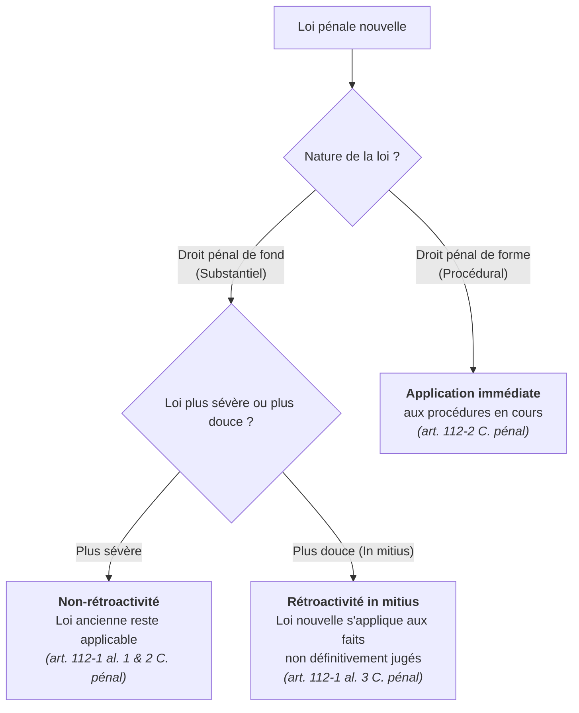

---
{"dg-publish":true,"permalink":"/application-de-la-loi-penale-dans-le-temps-et-l-espace/","ctime":"2026-10-13T23:26:07.929+02:00","mtime":"2026-10-13T23:33:04.701+02:00","dg-note-properties":{"subject":"[[References/Pénal]]","date created":"2026-10-13, 23 26","date modified":"2026-10-13, 23 33","sector":"[[References/AES]]","semester":"[[References/S3]]","class":"[[References/Pénal]]","form":"[[References/CM]]","part":"[[References/2]]"}}
---

# Application de la loi pénale dans le temps et l espace

### Titre 2 - L'application de la norme pénale

> [!abstract] **Principes d'application de la règle pénale**
>* **Durée d'application** : Par principe, la norme pénale est applicable de son entrée en vigueur jusqu'à son **abrogation**.
>* **Entrée en vigueur** : Les lois et actes administratifs entrent en vigueur le **lendemain de leur publication** au Journal Officiel.
>* **Différé d'entrée en vigueur** : Le législateur peut reporter l'entrée en vigueur pour des raisons d'adaptation pédagogique ou d'organisation administrative.
>  * *Exemple* : La [[loi du 9 mars 2004\|loi du 9 mars 2004]] a supprimé le principe de spécialité pour la responsabilité pénale des personnes morales, mais son entrée en vigueur a été différée au [[31 décembre 2005\|31 décembre 2005]].

>[!quote] **Portalis** – *"Avertir avant de frapper."*

>[!cite] **[[Article 8 DDHC 1789\|Article 8 DDHC 1789]]**
*"La loi ne doit établir que des peines strictly et évidemment nécessaires, et nul ne peut être puni qu'en vertu d'une loi établie et promulguée antérieurement au délit, et légalement appliquée."*

>[!cite] **[[Article 7 CEDH\|Article 7 CEDH]]**
*"Nul ne peut être condamné pour une action ou une omission qui, au moment où elle a été commise, ne constituait pas une infraction d'après le droit national ou international. De même, il ne peut être infligé aucune peine plus forte que celle qui était applicable au moment où l'infraction a été commise."*

---

#### Chapitre 1 - L'application de la loi pénale dans le temps

##### 1. Les règles de conflit applicables au droit pénal de fond

* **Condition préalable du conflit de lois** : Un fait commis sous l'empire de la loi ancienne **ne doit pas avoir fait l'objet d'une condamnation définitive** (épuisement des voies de recours ou expiration des délais d'exercice de ces recours). Ce qui est définitivement jugé ne peut plus être remis en cause.

###### A. Le principe de non-rétroactivité des lois pénales de fond plus sévères

* **Ancrage légal** : [[art. 112-1 al. 1 et 2 du Code pénal\|art. 112-1 al. 1 et 2 du Code pénal]]
  * *Alinéa 1* : Sont seuls punissables les faits constitutifs d'une infraction à la date à laquelle ils ont été commis.
  * *Alinéa 2* : Peuvent seules être prononcées les peines légalement applicables à la même date.

* **Critère de comparaison** : Analyse comparative entre la loi ancienne et la loi nouvelle. Si la loi nouvelle aggrave la situation pénale, elle ne s'applique pas aux faits antérieurs.

* **Domaine des dispositions plus sévères** :
  * **Relatif aux incriminations** :
    * Création d'une nouvelle incrimination.
    * Élargissement du champ d'application d'une incrimination existante (ex. suppression de la condition de subordination hiérarchique en matière de harcèlement sexuel).
    * Suppression d'une condition d'irresponsabilité ou élargissement de la responsabilité (ex. suppression du principe de spécialité des personnes morales par la [[loi du 9 mars 2004\|loi du 9 mars 2004]]).
  * **Relatif aux pénalités** :
    * Création d'une nouvelle circonstance aggravante.
    * Augmentation du quantum maximal d'une peine.
    * Adjonction d'une peine complémentaire obligatoire ou facultative.
    * Passage d'un délit à un crime (*criminalisation légale*).

###### B. L'exception : La rétroactivité *in mitius* des lois pénales de fond plus favorables

>[!cite] **[[art. 112-1 al. 3 du Code pénal\|art. 112-1 al. 3 du Code pénal]]**
*"Toutefois, les dispositions nouvelles s'appliquent aux infractions commises avant leur entrée en vigueur et n'ayant pas donné lieu à une condamnation passée en force de chose jugée lorsqu'elles sont moins sévères que les dispositions anciennes."*

* **Justification** : Fonde la réaction pénale sur la nécessité stricte des peines. Si la société estime qu'un comportement est moins grave ou ne doit plus être sanctionné, la répression antérieure n'a plus de légitimité sociale.

* **Domaine des dispositions plus douces (*in mitius*)** :
  * **Relatif aux incriminations** :
    * Suppression d'une incrimination (*dépénalisation*).
    * Restriction des éléments constitutifs de l'infraction (ex. ajout d'une condition supplémentaire pour retenir l'infraction).
    * Création ou élargissement d'un fait justificatif, d'une cause de non-imputabilité ou d'une immunité (ex. élargissement de l'immunité familiale en matière de vol entre époux).
  * **Relatif aux pénalités** :
    * Suppression d'une peine principale ou complémentaire.
    * Suppression d'une circonstance aggravante.
    * Diminution du quantum de la peine encourue.
    * Transformation d'un crime en délit (*correctionnalisation légale*).

| Type de loi nouvelle (Fond) | Qualification juridique | Effet dans le temps |
| :--- | :--- | :--- |
| **Création d'une infraction / Réponse plus sévère** | Loi de fond plus sévère | **Non-rétroactivité** (Appliquée uniquement aux faits futurs) |
| **Dépénalisation / Peine réduite / Immunité** | Loi de fond plus douce (*In mitius*) | **Rétroactivité *in mitius*** (Appliquée aux faits non définitivement jugés) |

###### C. La mise en œuvre des principes : la qualification et le moment de commission de l'infraction

Pour déterminer quelle loi s'applique, le juge doit localiser précisément la date de consommation de l'élément matériel de l'infraction :

1. **Infractions instantanées** :
   * *Définition* : L'élément matériel se réalise en un trait de temps immédiatement (ex. le *vol* par soustraction frauduleuse).
   * *Régime* : La date de l'acte matériel fixe la loi applicable. Si l'acte a lieu avant la loi nouvelle, la loi ancienne régit l'infraction.

2. **Infractions continues** :
   * *Définition* : L'élément matériel se prolonge dans le temps par la réitération d'une volonté coupable (ex. le *recel* par détention d'une chose volée).
   * *Régime* : Si l'activité délictuelle se poursuit après l'entrée en vigueur de la loi nouvelle, la loi nouvelle s'applique immédiatement à l'ensemble du comportement sans poser de difficulté de rétroactivité.

3. **Infractions d'habitude** :
   * *Définition* : L'élément matériel exige la répétition d'au moins deux actes identiques pour être constitué (ex. *exercice illégal de la médecine*, *appels téléphoniques malveillants*).
   * *Régime* : Si le premier acte est commis sous la loi ancienne et le second sous la loi nouvelle, l'infraction n'est consommée qu'au jour du second acte. La loi nouvelle s'applique donc directement.

---

##### 2. Le principe de l'application immédiate du droit pénal formel

>[!abstract] **Règle générale de procédure**
>* **Textes d'ancrage** : Articles [[art. 112-2 du Code pénal\|112-2 à 112-4 du Code pénal]].
>* **Principe** : Les lois de procédure (droit pénal de forme) sont d'**application immédiate** aux procédures en cours dès leur entrée en vigueur, tant que la décision sur le fond n'est pas devenue définitive.
>* **Raison d'être** : Les lois de procédure sont présumées assurer une meilleure administration de la justice.

* **Domaine d'application de la loi de forme** :
  1. **Lois de compétence et d'organisation judiciaire** (ex. création ou transfert de compétence vers une nouvelle juridiction).
  2. **Lois régissant les formes du procès et le déroulement de la procédure** (ex. règles relatives aux voies de recours ou aux actes d'enquête).
  3. **Lois relatives à la prescription de l'action publique** :
     * S'appliquent immédiatement aux prescriptions en cours non encore acquises.
     * *Exemple* : La [[loi du 27 février 2017\|loi du 27 février 2017]] a allongé les délais de prescription de droit commun de 3 à 6 ans pour les délits, et de 10 à 20 ans pour les crimes.
  4. **Lois relatives à l'exécution et au régime d'application des peines** (ex. règles sur la libération conditionnelle ou l'aménagement de peine).

>[!important] **Réserve des actes accomplis**
>L'application immédiate n'invalide pas les actes régulièrement accomplis sous l'empire de la loi ancienne. Elle saisit la procédure dans l'état où elle se trouve.

---

#### Chapitre 2 - L'application de la loi pénale dans l'espace

>[!abstract] **Principe de coïncidence des compétences**
>En droit pénal, la compétence de la loi pénale d'un État et la compétence de ses juridictions répressives sont indissociables : dès lors que la **loi pénale française** est applicable, le **juge pénal français** est exclusivement compétent pour l'appliquer.

##### Les 4 systèmes théoriques d'application de la loi dans l'espace

| Système théorique | Critère de rattachement | Avantages / Inconvénients |
| :--- | :--- | :--- |
| **1. Territorialité** | Lieu de commission de l'infraction sur le territoire de l'État. | Respect parfait de la souveraineté territoriale, mais inopérant pour les faits commis à l'étranger. |
| **2. Personnalité (Compétence personnelle)** | Nationalité de l'auteur (**personnalité active**) ou de la victime (**personnalité passive**). | Poursuit les nationaux à l'étranger ou protège les victimes nationales, mais crée des conflits de souveraineté. |
| **3. Compétence réelle** | Nature de l'infraction (Atteinte aux intérêts supérieurs de l'État : trahison, espionnage). | Protection ciblée de la sécurité nationale, quelle que soit la nationalité ou le lieu. |
| **4. Compétence universelle** | Lieu d'arrestation du délinquant sur le territoire. | Empêche l'impunité internationale des crimes graves, mais tributaire du lieu d'arrestation. |

>[!info] **Option retenue par le droit pénal français**
>Le droit français adopte une **approche combinée** :
>* **Principe fondamental** : La **territorialité** (compétence principale et exclusive sur le territoire national).
>* **Régimes subsidiaires** : La compétence personnelle, réelle et universelle interviennent par défaut pour étendre la compétence française aux faits commis hors du territoire.

---

##### 1. Les infractions commises sur le territoire de la République (Compétence territoriale)

>[!cite] **[[art. 113-2 al. 1 du Code pénal\|art. 113-2 al. 1 du Code pénal]]**
>*"La loi pénale française est applicable aux infractions commises sur le territoire de la République."*

* **Portée du principe** : Principe général et absolu. Il s'applique aux auteurs et victimes français comme étrangers, dès lors que l'infraction est localisée sur le territoire national.

###### Définition juridique du territoire français ([[art. 113-1 du Code pénal\|art. 113-1 du Code pénal]])

1. **Espace terrestre** :
   * La France métropolitaine.
   * Les départements d'outre-mer (**DOM**) : Guadeloupe, Martinique, Guyane, La Réunion, Mayotte.
   * Les collectivités et territoires d'outre-mer (**COM/TOM**) : Nouvelle-Calédonie, Polynésie française, Wallis-et-Futuna, etc.

2. **Espace maritime** :
   * Comprend les eaux intérieures et la **mer territoriale** fixée à **12 milles marins** à partir des lignes de base ([[loi du 24 décembre 1971\|loi du 24 décembre 1971]]).
   * Au-delà des 12 milles, s'ouvre la haute mer (espace international).

3. **Espace aérien** :
   * Survol de l'espace terrestre et de la mer territoriale française, sans limitation d'altitude.

4. **Espaces assimilés au territoire national** :
   * **Navires** battant pavillon français.
   * **Aéronefs** immatriculés en France.
   * Les infractions commises à leur bord sont juridiquement réputées commises sur le territoire français.
