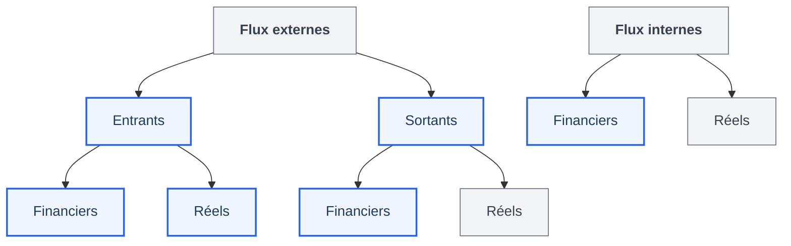

---
{"dg-publish":true,"permalink":"/comptabilite-financiere/","tags":["AES/S3/compta","CM","maths","AES/S3"],"ctime":"2026-09-15T16:26:55.252+02:00","mtime":"2026-10-13T17:34:01.965+02:00","dg-note-properties":{"tags":["AES/S3/compta","CM","maths","AES/S3"],"class":"[[References/Compta]]","sector":"[[References/AES]]","semester":"[[References/S3]]","form":"[[References/CM]]","part":"[[References/1]]","date created":"2026-09-15, 16 26","date modified":"2026-09-21, 23 12"}}
---

# Comptabilité Financière

# I. Vue d'ensemble de la comptabilité

> [!abstract] Comparatif des comptabilités
> 
> | Critère | Comptabilité Financière (Générale) | Comptabilité de Gestion (Analytique) |
> | :--- | :--- | :--- |
> | **Caractère** | **Obligatoire** | **Facultative** |
> | **Destinataires** | **Publique** (tiers, État, associés) | **Confidentielle** (interne) |
> | **Exigence** | **Traçabilité stricte** | Analyse des coûts & décisions |
> | **Objectif** | Refléter l'**exacte situation financière** à la clôture de l'exercice (12 mois) via 2 documents de synthèse : le **Bilan** et le **Compte de Résultat**. | Évaluer les coûts, les marges et la rentabilité par activité. |

# II. Le Bilan Comptable

> [!info] Définition du Bilan
> Le **Bilan** représente la **situation patrimoniale** de l'entreprise à un instant T (image patrimoniale à la date de clôture de l'exercice).

## Structure du Bilan

| **ACTIF** *(Ce que l'entreprise possède)* | **PASSIF** *(Ce que l'entreprise doit / Ressources)* |
| :--- | :--- |
| **Immobilisations** *(Classe 2)* : Biens durables conservés > 1 an - *Incorporelles* (Compte 20 : fonds de commerce, droit au bail) - *Corporelles* (Compte 21 : terrains, constructions, matériel) - *Financières* (Compte 26/27 : titres de participation, dépôts) | **Capitaux propres** *(Classe 1)* : - *Capital social* (apports des associés) - *Réserves* - *Résultat de l'exercice* (Bénéfice ou Perte) - *Subventions d'investissement* |
| **Stocks** *(Classe 3)* : Matières premières, marchandises en stock | **Provisions** *(Classe 1)* : - *Provisions réglementées* - *Provisions pour risques et charges* |
| **Créances** *(Classe 4)* : Sommes dues par les clients | **Dettes** *(Classe 1 & 4)* : - *Emprunts et dettes financières* (Classe 1) - *Dettes fournisseurs* (Classe 4) - *Dettes fiscales et sociales* (Classe 4) |
| **Trésorerie active** *(Classe 5)* : - *Banque* (solde débiteur) - *Caisse* | **Trésorerie passive** *(Classe 5)* : - *Banque / Découvert bancaire* (solde créditeur) |
| **TOTAL ACTIF** | **TOTAL PASSIF** |

> [!tip] Règle d'équilibre
> Le Bilan est **toujours équilibré** :  
> $$\text{TOTAL ACTIF} = \text{TOTAL PASSIF}$$

# III. Le Compte de Résultat

> [!summary] Définition
> Le **Compte de Résultat** retrace l'ensemble des variations d'enrichissement et d'appauvrissement de l'entreprise au cours de l'exercice comptable.

| **CHARGES** *(Classe 6 - Emplois / Appauvrissement)* | **PRODUITS** *(Classe 7 - Ressources / Enrichissement)* |
| :--- | :--- |
| - **Achats & Variation de stocks** *(Classe 60)* - **Services extérieurs / Charges externes** *(Classe 61/62)* - **Impôts et taxes** *(Classe 63)* - **Charges de personnel** *(Classe 64 : salaires, cotisations)* - **Autres charges de gestion courante** *(Classe 65)* - **Charges financières** *(Classe 66 : intérêts d'emprunt)* - **Charges exceptionnelles** *(Classe 67)* - **Dotations aux amortissements et provisions** *(Classe 68)* - **Participation & Impôt sur les bénéfices** *(Classe 69)* | - **Ventes de produits / marchandises** *(Classe 70)* - **Production stockée & immobilisée** *(Classe 71/73)* - **Subventions d'exploitation** *(Classe 74)* - **Autres produits de gestion courante** *(Classe 75)* - **Produits financiers** *(Classe 76 : intérêts reçus)* - **Produits exceptionnels** *(Classe 77)* - **Reprises sur amortissements et provisions** *(Classe 78)* |
| **TOTAL CHARGES (C)** | **TOTAL PRODUITS (P)** |

## Calcul du Résultat

> [!note] Détermination du Résultat
> - **Si Produits > Charges (P > C) :** ==BÉNÉFICE==  
> $$\text{Résultat} = \text{Produits} - \text{Charges}$$
> - **Si Charges > Produits (C > P) :** ==DÉFICIT / PERTE==  
> $$\text{Résultat} = \text{Charges} - \text{Produits}$$

# IV. Principes Comptables Fondamentaux

> [!summary] **Image Fidèle**
> *"Le respect de l'ensemble des principes doit permettre d'obtenir une image fidèle du patrimoine, de la situation financière et du résultat de l'entreprise."*

Toutes les règles comptables s'articulent autour d'un seul objectif : refléter le plus exactement possible la réalité économique et patrimoniale de l'entreprise pour les tiers (associés, banques, État, fournisseurs).  

## Les 8 Principes Comptables Détaillés

### 1. Principe de Continuité de l'Exploitation
> [!quote] **Définition du PCG** :* "Pour l'établissement des comptes annuels, le commerçant, personne physique ou morale, est présumé poursuivre ses activités."*
- **Signification :** On suppose que l'entreprise va continuer son activité au-delà de la clôture de l'exercice. Les actifs ne sont donc pas évalués à leur valeur de liquidation ou de revente immédiate.
### 2. Principe de Régularité
> [!quote] **Définition du PCG** : *"La comptabilité est conforme aux règles et procédures en vigueur."*
- **Signification :** Respect strict des normes du Plan Comptable Général (PCG) et des dispositions légales ou réglementaires.
### 3. Principe de Sincérité
> [!quote] **Définition du PCG** : *"Les règles et procédures sont appliquées avec sincérité, afin de traduire la connaissance que les responsables de l'établissement des comptes ont de la réalité et de l'importance relative des événements enregistrés."*
- **Signification :** Les dirigeants doivent faire preuve de bonne foi. Les documents comptables ne doivent ni masquer la réalité, ni la travestir.
### 4. Règle des Coûts Historiques
> [!quote] **Définition du PCG** : *"La méthode de base retenue pour l'évaluation des éléments inscrits en comptabilité est la méthode du coût historique."*
- **Signification :** Les biens entrent dans le patrimoine à leur valeur nominale d'acquisition (coût d'achat HT) et restent inscrits à cette valeur sans réévaluation au gré du marché ou de l'inflation.
### 5. Principe de Prudence
> [!quote] **Définition du PCG* : *"L'appréciation raisonnable des faits, afin d'éviter le risque de transfert sur l'avenir, d'incertitudes présentes susceptibles de grever le patrimoine et le résultat de l'entreprise."*
- **Signification :** Une perte ou une charge probable est comptabilisée immédiatement (dépréciation ou provision), alors qu'un gain virtuel ou potentiel n'est jamais enregistré tant qu'il n'est pas définitivement réalisé.
### 6. Règle de Non-Compensation
> [!quote] **Définition du PCG** : *"Les opérations sont enregistrées dans les comptes dont l'intitulé correspond à leur nature. Toute compensation est interdite sauf lorsqu'elle est explicitement prévue par les dispositions en vigueur."*
- **Signification :** On ne peut pas compenser des dettes et des créances, ou des charges et des produits, afin de conserver la visibilité de chaque flux.
### 7. Règle d'Indépendance des Exercices (Séparation des exercices)
> [!quote] **Définition du PCG** : *"Pour calculer le résultat par différence entre les produits et les charges de l'exercice, sont rattachés à l'exercice : les produits acquis à cet exercice et les charges supportées par l'exercice."*
- **Signification :** Chaque exercice (période de 12 mois) est indépendant. Les produits et charges sont rattachés à l'exercice où le fait générateur a lieu (livraison/prestation), indépendamment du paiement.
### 8. Principe de Permanence des Méthodes
> [!quote] **Définition du PCG** : *"La cohérence des informations comptables au cours des périodes successives implique la permanence dans l'application des règles et procédures."*
- **Signification :** Les méthodes d'évaluation doivent rester identiques d'un exercice à l'autre pour garantir la comparabilité des états financiers dans le temps.

# V. Les Flux et la Partie Double

<mark style="background:#9cdef8">aaat</fon></mark> : Enregistrement comptable obligatoire

## Classification des Flux

- **Flux Externes :** Entre l'entreprise et ses partenaires (clients, fournisseurs, banque, État, salariés).
- **Flux Internes :** Mouvements au sein de l'entreprise.
  
Chaque flux se caractérise par :
- Sa direction : **Entrant** ou **Sortant**
- Sa nature : **Réel** (marchandises, biens, services) ou **Financier** (monnaie, créances, dettes).

## Le Principe de la Partie Double

> [!check] Règle Fondamentale
> Tout enregistrement comptable doit respecter le principe de la **partie double** :
> 
> $\text{EMPLOIS (Débit)} = \text{RESSOURCES (Crédit)}$
> 
> À chaque flux dans un sens correspond un flux de sens opposé pour un **montant strictement identique**.
  
  
**EXO à faire sur le circuit**  

## Exemple

L'entreprise vend à son client Pierre 1000 $\text{€}$ de marchandises

