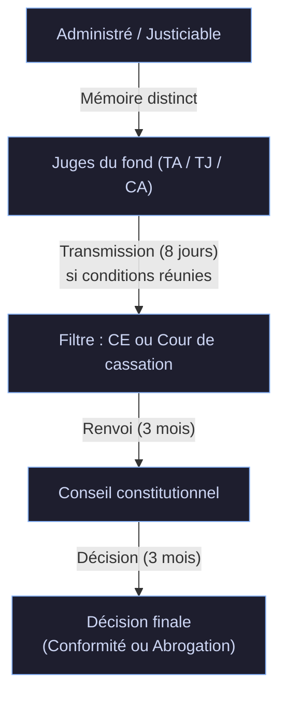

---
{"dg-publish":true,"permalink":"/controle-constitutionnel-et-qpc/","ctime":"2026-10-13T21:45:40.779+02:00","mtime":"2026-10-13T23:24:11.405+02:00","dg-note-properties":{"date created":"2026-10-13, 21 45","date modified":"2026-10-13, 23 24","sector":"[[References/AES]]","semester":"[[References/S3]]","class":"[[References/Administratif]]","form":"[[References/CM]]","part":"[[References/2]]"}}
---

# Contrôle Constitutionnel et QPC

> [!note] **Synthèse générale**
> En principe, le juge administratif refuse de contrôler la constitutionnalité d'une loi : c'est la **théorie de la loi écran** (fondée sur l'[[Arrêt Arrighi\|Arrêt Arrighi]] de 1936). Pour atténuer les dérives d'une loi inconstitutionnelle maintenue dans l'ordre juridique, le juge administratif a d'abord développé des correctifs jurisprudentiels (écran transparent, interprétation conforme). La réforme de 2008 a ensuite instauré un correctif institutionnel majeur : la **Question Prioritaire de Constitutionnalité (QPC)**, permettant un contrôle *a posteriori* des lois par le [[Conseil constitutionnel\|Conseil constitutionnel]].

---

## I. Le principe d'incompétence du juge administratif et la théorie de la loi écran

### A. Le principe d'incompétence du juge administratif

* **Incompétence historique** : Dès avant la création du [[Conseil constitutionnel\|Conseil constitutionnel]] (1958), le juge administratif s'est déclaré incompétent pour apprécier la conformité d'une loi à la Constitution.
* **Arrêt de principe** : ==[[Arrêt Arrighi\|Arrêt Arrighi]] (Conseil d'État, 6 novembre 1936)==.
  * **Règle posée** : Le moyen tiré de l'inconstitutionnalité d'une loi est **irrecevable** devant le juge administratif.
  * **Portée** : Un administré contestant un acte administratif ne peut pas soutenir que cet acte est illégal au motif que la loi sur laquelle il se fonde est contraire à la Constitution. Le juge administratif estime qu'il n'a pas reçu mandat constitutionnel pour juger la loi.

>[!info] **Position du juge administratif**
>Face à un moyen fondé sur l'inconstitutionnalité d'une loi, le juge administratif ne se prononce pas sur la validité intrinsèque de la loi : il la constate, l'applique et rejette le moyen comme irrecevable.

---

### B. La théorie de la loi écran

* **Définition** : La loi s'interpose entre l'acte administratif et la norme constitutionnelle (" ==la loi fait écran== ").
* **Mécanisme** :
  1. L'administration prend un acte unilatéral en application d'une loi.
  2. L'acte administratif est conforme à la loi.
  3. Même si la loi est inconstitutionnelle, le juge administratif ne peut s'immiscer dans l'appréciation de la loi votée par le Parlement.
* **Inconvénients majeurs** :
  * **Survivance de normes inconstitutionnelles** : L'administration continue d'appliquer une loi inconstitutionnelle sans qu'aucun juge ordinaire ne puisse la paralyser.
  * **Atteinte au principe de constitutionnalité** : Dans la quasi-totalité des cas (plus de 99 % des actes), les décisions administratives sont prises sur le fondement d'une habilitation législative. La théorie de la loi écran neutralise donc le contrôle constitutionnel effectif de l'action administrative.

---

### C. Les correctifs jurisprudentiels développés par le juge administratif

Afin d'atténuer la rigueur de la loi écran, le [[Conseil d'État\|Conseil d'État]] a progressivement élaboré des mécanismes de contournement :

#### 1. La théorie de l'écran transparent
* **Principe** : Lorsque la loi est extrêmement vague, imprécise ou se borne à renvoyer au pouvoir réglementaire la création réelle des droits et obligations.
* **Effet** : Le juge administratif considère que la substance de la norme réside dans l'acte administratif et non dans la loi. La loi est qualifiée de " ==transparente== ", permettant au juge de contrôler directement la conformité de l'acte aux normes constitutionnelles.

#### 2. L'interprétation conforme de la loi
* **Principe** : Confronté à une loi dont l'application pourrait violer la Constitution, le juge administratif retient l'interprétation du texte qui assure la meilleure compatibilité avec les exigences constitutionnelles.
* **Effet** : Maintient la primauté pratique des droits constitutionnels sans déclarer la loi formellement inconstitutionnelle.

---

## II. Le correctif institutionnel : La Question Prioritaire de Constitutionnalité (QPC)

### A. Origine, fondement et objectifs

* **Transition du contrôle constitutionnel** :
  * **Contrôle *a priori*** (Art. 61 de la Constitution) : Instauré en 1958, exercé uniquement avant la promulgation de la loi sur saisine politique (Président, PM, Présidents des Assemblées, et depuis 1974 par 60 députés ou 60 sénateurs).
  * **Lacune** : Les lois non déférées au Conseil constitutionnel entraient définitivement dans le droit positif et bénéficiaient de l'écran législatif.
* **Instauration du contrôle *a posteriori*** :
  * **Ancrage constitutionnel** : **[[Loi constitutionnelle du 23 juillet 2008\|Loi constitutionnelle du 23 juillet 2008]]** insérant l'==[[Article 61-1 de la Constitution\|Article 61-1 de la Constitution]]==.
  * **Loi d'application** : **[[Loi organique du 10 décembre 2009\|Loi organique du 10 décembre 2009]]**.
  * **Entrée en vigueur** : ==1er mars 2010==.
* **Principe clé** : Permet à tout justiciable de contester la constitutionnalité d'une disposition législative déjà en vigueur à l'occasion d'une instance en justice.
* **Monopole préservé** : Seul le [[Conseil constitutionnel\|Conseil constitutionnel]] peut déclarer une loi inconstitutionnelle. Les juges administratifs et judiciaires agissent uniquement comme des filtres.

---

### B. Les quatre conditions de recevabilité de la QPC

Pour qu'une QPC soit transmise, la disposition contestée doit satisfaire simultanément **quatre conditions de fond** (Art. 61-1 C) :

1. **Atteinte aux droits et libertés constitutionnellement garantis** :
   * La QPC est exclusivement un outil de protection des droits et libertés fondamentaux (DDHC, Préambule de 1946, Charte de l'environnement).
   * *Exclusion* : La simple méconnaissance de règles de procédure législative ne peut pas fonder une QPC.
2. **Applicabilité de la disposition au litige** :
   * Le texte législatif attaqué doit constituer le fondement juridique direct du litige pendant devant le juge.
3. **Absence de déclaration préalable de conformité** :
   * Le [[Conseil constitutionnel\|Conseil constitutionnel]] ne doit pas s'être déjà prononcé sur la disposition dans les motifs et le dispositif d'une décision précédente, sauf en cas de changement de circonstances (droit ou fait).
4. **Caractère nouveau ou sérieux** :
   * **Nouveauté** : La question soulevée n'a jamais été tranchée par le Conseil constitutionnel (ex. modification postérieure de la Constitution).
   * **Sérieux** : Le moyen présente un doute réel quant à la constitutionnalité de la loi (évite les manœuvres dilatoires).

>[!warning] **Exigence de forme**
>La QPC doit obligatoirement être présentée sous la forme d'un **mémoire distinct et motivé**, sous peine d'irrecevabilité absolue.

---

### C. La procédure de filtrage et les délais

Le mécanisme repose sur un **double filtrage** rapide pour éviter l'engorgement du Conseil constitutionnel et prévenir l'allongement abusif des procès :

1. **Premier niveau (Juge du fond - TA, TGI, CA)** :
   * Vérification sommaire des conditions dans un délai strict de **8 jours**.
   * En cas de refus : pas de recours direct autonome, mais la demande peut être réitérée en appel ou en cassation.
2. **Second niveau (Conseil d'État ou Cour de cassation)** :
   * Examen approfondi des critères de fond dans un délai de **3 mois**.
   * Rôle de filtre sélectif : transmission uniquement des questions réellement sérieuses ou nouvelles.
3. **Décision du Conseil constitutionnel** :
   * Dispose de **3 mois** pour statuer.
   * Procédure contradictoire garantissant les droits de la défense.
   * **Délai maximal total de la procédure** : ~ **6 mois et 8 jours**.

---

### D. Les effets de la décision QPC

* **Si la loi est déclarée conforme** : Rejet de la QPC. La loi est définitivement purgée et le procès principal reprend son cours.
* **Si la loi est déclarée inconstitutionnelle** :
  * **Abrogation de la disposition** : En vertu de l'==[[Article 62 alinéa 2 de la Constitution\|Article 62 alinéa 2 de la Constitution]]==, la disposition est supprimée de l'ordre juridique.
  * **Effet pour l'avenir** : La loi abrogée ne peut plus recevoir d'application pour les situations futures.

> [!example] **Modulation dans le temps et abrogation différée**
> Le Conseil constitutionnel peut **différer la date d'abrogation** (ex. délai de 6 mois ou 1 an) pour éviter de créer un vide juridique encore plus préjudiciable que l'inconstitutionnalité elle-même.
> * *Exemple du cours* : Le contentieux de la CDDisation/CDIisation des agents contractuels de la fonction publique au bout de 6 ans. Le Conseil constitutionnel ayant constaté qu'une catégorie d'agents avait été oubliée par le législateur, il a différé l'abrogation de l'article pour laisser 1 an au Parlement pour corriger la loi, tout en posant une réserve d'interprétation immédiatement applicable.

---

## III. Ouverture : L'articulation avec les normes internationales et européennes

En conclusion de la hiérarchie des normes constitutionnelles, l'étude s'oriente vers les normes internationales et européennes :

### A. La diversité des normes internationales
* Comprend les traités et conventions internationales, la coutume internationale ainsi que les principes généraux du droit international (PGDI).

### B. La distinction fondamentale entre CEDH et Droit de l'UE
* **La Convention Européenne des Droits de l'Homme (CEDH - 1950)** :
  * Issue du Conseil de l'Europe.
  * Placée sous le contrôle de la **[[Cour européenne des droits de l'homme (CEDH)\|Cour européenne des droits de l'homme (CEDH)]]**.
  * Conserve dans la hiérarchie des normes le statut classique d'un traité international.
* **Le Droit de l'Union Européenne** :
  * Issu du Traité de Rome (1957), restructuré par le TUE et le TFUE.
  * Constitue un **ordre juridique propre, autonome et spécifique**, distinct du droit international classique.
  * Comprend le **droit originaire** (les traités) et le **droit dérivé** (règlements, directives, décisions).
