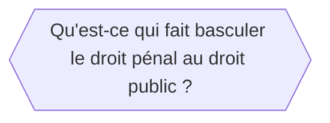
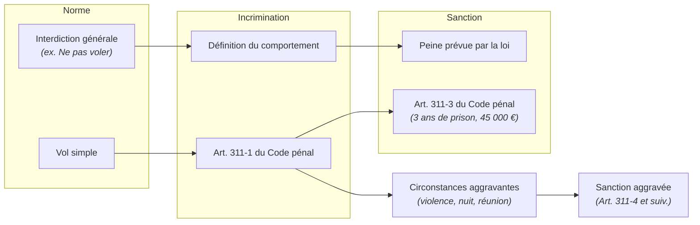

---
{"dg-publish":true,"permalink":"/introduction-penal/","tags":["AES/S3/pénal","CM","droit","AES/S3"],"ctime":"2026-09-09T10:11:57.813+02:00","mtime":"2026-10-13T17:34:02.206+02:00","dg-note-properties":{"tags":["AES/S3/pénal","CM","droit","AES/S3"],"class":"[[References/Pénal]]","sector":"[[References/AES]]","semester":"[[References/S3]]","form":"[[References/CM]]","part":null,"date created":"2026-09-09, 10 11","date modified":"2026-09-22, 21 16"}}
---

# I. Définition du droit pénal

- Pénal vient de **poena**, *peine* en latin

> [!abstract]
> - **Le pénal est le droit de la paix**

- **Au-delà de la répression** : Bien qu'il remplisse une fonction répressive et dissuasive (notamment par les peines privatives de liberté, la peine de mort ayant été abolie par la [[loi du 9 octobre 1981\|loi du 9 octobre 1981]], le droit pénal ne se réduit pas à **la seule sanction**.
  
- **Diversité des sanctions** : La réponse pénale intègre d'autres types de mesures, comme des **mesures éducatives** (réservées au mineur) ou **préventives** (ex. injonctions de soins pour lutter contre la récidive).
  
- **Repère juridique et valeurs sociales** : Comme le soulignait Robert Badinter, le droit pénal a une **fonction expressive**. C'est un " droit déterminateur " qui pose des **repères juridiques** en fixant la frontière entre le permis et l'interdit, affirmant ainsi les **valeurs sociales** essentielles protégées par la société (comme l'interdiction de tuer).

> [!bug] Citation
> ***Tout ce qui n'est pas interdit est permis dans une société démocratique***  
> Loysel / [[Article 5 DDHC 1789\|Article 5 DDHC 1789]]

- **Le droit pénal évolue dans le temps en fonction de**

1. **La conscience sociale** 
	- on ne parle plus d'attentat à la pudeur mais d'agression sexuelle
	- à partir du [[13 avril 2016\|13 avril 2016]], la prostitution est désormais répréhensible pour les clients et non plus pour les praticiennes
	  
2. **La nécessité sociale**
	- l'interdiction de fumer dans les espaces publics est une contravention passible pénalement depuis un [[décret de 2006\|décret de 2006]]

3. **L'émergence de nouveaux comportements**
	- [[la loi du 11 octobre 2010\|la loi du 11 octobre 2010]] qui a créée l'infraction de dissimulation forcée du visage, directement entrée en vigueur
	- le texte qui concerne le port volontaire d'une tenue qui dissimule le visage dans l'espace public, a été reporté à une durée de 6 mois pour des **raisons pédagogiques**, et est entré en vigueur [[le 11 avril 2011\|le 11 avril 2011]]
	- certains faits sociaux, selon **Mireille Delmas-Marty** qui parle de "*droit pénal magique*" pour désigner le recours systématique au pénal

> [!abstract]
> Le droit pénal donne la mesure du fait illicite dans une société donnée à un instant T. Il suffit à cet égard de constater que sous l'empire du Code pénal Napoléonien, le meurtre était passible de la peine de mort, et qu'il est aujourd'hui puni d'une peine de 30 ans de réclusion criminelle ou bien s'il y a préméditation de la peine de perpétuité et de la qualification d'assassinat

Merle et Vitu sont des auteurs du XXe siècle ayant publié le ***Traité de Droit Criminel***, qui définit le droit pénal :

> [!bug] Citation
> 
> ***Un ensemble de règles juridiques ayant pour objet la réaction sociale au phénomène criminel, phénomène qui se définit par des comportement de différents degrés et divers formes qui portent atteinte à l'ordre social et à la sécurité publique.***

Le droit pénal contemporain s'articule autour de deux branches fondamentales, le **droit pénal de fond** (substantiel) et le **droit pénal de forme** (procédure).  
Le **Code pénal actuel** est entré en vigueur [[le 1er mars 1994\|le 1er mars 1994]] (après quatre lois [[du 22 juillet 1992\|du 22 juillet 1992]]) pour abroger et remplacer le Code pénal de 1810.

1. **Le droit Pénal de fond ou substantiel** est un droit qui appréhende certains faits précis en infraction, les soumet à un régime précis. Il se divise en deux catégories :

	- **Le **droit pénal général**, contenu dans le [[livre 1 du Code pénal\|livre 1 du Code pénal]]  
	  Il va s'agir de donner à toutes les infractions quelles qu'elles soient des bases communes de fonctionnement, qui relèvent à la fois des principes directeurs, et des conditions de la responsabilité pénale

	- **Le droit pénal spécial**, caractérisé dans le ***catalogue des infractions***, est contenu au sein du Code pénal actuel dans [[les livres 2 à 5-6\|les livres 2 à 5-6]], dans lesquels figurent les infractions pouvant être commises par n'importe quel citoyen.
	  
> [!important]
> **Le droit pénal spécial reste assujetti au livre premier**
>  

- **Ce catalogue d'infractions est classé selon les valeurs sociales protégées**

| Livre   | Désignation                                                        | Exemples                                                                       |
| ------- | ------------------------------------------------------------------ | ------------------------------------------------------------------------------ |
| Livre 2 | la personne                                                        | - son intégrité physique et psychique - sa dignité                          |
| Livre 3 | les biens                                                          |                                                                                |
| Livre 4 | crimes et délits contre la nation, l'État et la paix publique      | - trahison, espionnage, terrorisme, faux - atteintes à l'autorité de l'État |
| Livre 5 | les valeurs sociales non contenues dans les deux précédents livres | - bioéthique, pratiques immorales                                              |
| Livre 6 | toutes les contraventions                                          |                                                                                |
| Livre 7 | dispositions applicables à l'outre-mer                             |                                                                                |

- En dehors du Code pénal dans d'autres lois spécifiques
	- par exemple, la loi sur la liberté de la presse
   
- Dans d'autres codes
	1. Code du travail
	2. Code du commerce
	3. Code de la santé publique
	4. Code de la consommation

2. **Le droit pénal de forme** organise également la façon dont il faut poursuivre les infractions avec des conditions et des délais spécifiques. 

	- Le droit pénal est régi par le **Code de procédure pénale**, promulgué en 1958 et [[entré en vigueur en 1959\|entré en vigueur en 1959]]
	- Il est organisé en fonction des phases propres à cette procédure et vient mettre un terme au [[CIC de 1808\|CIC de 1808]]

| Phases           | Enquêtes         | Poursuites                                                          | Instruction                                                                       | Jugement                                                                                                                                                     |
| ---------------- | ---------------- | ------------------------------------------------------------------- | --------------------------------------------------------------------------------- | ------------------------------------------------------------------------------------------------------------------------------------------------------------ |
| Acteurs          | Police, OPJ      | Ministère public                                                    | - Juge d'instruction, magistrat - Ministère public est avisé et donne son avis | - Tribunal de police - Tribunal correctionnel  - Cour criminelle départementale  - Cour d'assises - Ministère public est avisé et donne son avis |
| Moyens           | Garde à vue      | Opportunité des poursuites : - classer l'affaire - poursuites | Enquête par moyens coercitifs : - détention provisoire                         | - Juridiction compétente (contraventions, délits crimes)                                                                                                     |
| Conclusion       | Compte-rendu     | Déclencher le procès pénal                                          | Procès pénal                                                                      | Directement en phase de jugement sans instruction                                                                                                            |
| Rend des comptes | Ministère public | Saisine du juge d'instruction                                       | Chambre de l'instruction                                                          |                                                                                                                                                              |

- **Dans le code pénal, la règle juridique dispose d'une numérotation décimale à 3 chiffres**
	- 1e chiffre : livre
	- 2e chiffre : titre
	- 3e chiffre : chapitre

# II. La nature du droit pénal
*Un droit mixte sous l'influence du droit international*

## A. Le droit pénal et son rapport aux branches du droit interne

1. Le droit public organise les rapports entre l'État et les individus, or c'est précisément ce qu'opère aussi le droit pénal.  
   Les organes étatiques agissent dans l'intérêt général, et c'est l'État (pour aller vite) qui conduit les poursuites.
   
2. La sanction pénale ne peut être prononcée que par une juridiction répressive. On est obligé de passer par un contentieux.
   
3. Le droit pénal repose sur des $\text{fondements constitutionnels}$ ([[articles 34 et 37 de la constitution de 1958\|articles 34 et 37 de la constitution de 1958]]).  
   Il a précisément objet de porter atteinte aux libertés de l'individu. Des principes constitutionnels font consacrer le droit à punir de l'État. 
	- Ex. Le principe de la légalité.
	- Le principe de non-rétroactivité, à postériori ou à priori
  
> [!abstract] De fait, le conseil constitutionnel constitue une constitutionnalisation du droit pénal de par ses contrôles

**Qu'est-ce qui fait basculer le droit pénal au droit public ?**

- Le droit pénal est attaché au droit privé puisqu'il règle également les rapports entre les particuliers.
- Ce sont les tribunaux judiciaires composés des mêmes magistrats qui œuvrent aussi bien au pénal qu'au civil

Il n'y a pas de cloisonnement mais une inter pénétration. Les tribunaux privés vont sanctionner des violations de droit privé comme des violations de droit publics.

### 2 . Un droit mixte
*Autonomisation fonctionnelle du droit pénal*

Le droit pénal n'est pas tributaire des catégories juridiques utilisées par les différentes branches du droit, lorsqu'il vient les sanctionner. 

Ex. **Violation de domicile**  
C'est une notion de droit civil mais le droit pénal n'est pas lié par la définition civiliste du domicile, puisque pour lui cela peut tout aussi bien désigner une domiciliation permanente que provisoire

Dans la corruption de fonctionnaire, fonctionnaire a un sens en droit civil, mais en droit privé le notaire est un fonctionnaire assujetti à cette incrimination.

## B. Le droit pénal et son rapport au droit européen

### 1 . Le droit du conseil de l'Europe

- La convention Européenne des droits de l'Homme, signée le [[4 novembre 1950\|4 novembre 1950]] à Rome et rentrée en vigueur le [[3 mai 1974\|3 mai 1974]] en France, contient un certain nombre de droits et de garanties fondamentaux.
- La cour européenne exerce la bonne application de ce droit dans ces pays. Elle s'applique après épuisement des recours au sein des pays.

> [!important] Cas particulier 
> - En France, une singularité **pénale** permet de **rejuger par conformité** une décision prise par la cour européenne.
> - Dans le **civil**, **on ne rejuge pas** la décision prise par la cour de cassation française.
> 
> - Cette décision est le fruit d'une loi du [[15 juin 2000\|15 juin 2000]], qui a encadré la norme pénale dans beaucoup de lois. 
> 	- *Ex. le cas de l'esclavage domestique et l'arrêt Silladin contre France, le [[19 octobre 2000\|19 octobre 2000]] où la cour européenne a sanctionné la France, qui n'avait pas sanctionné un individu, faute de texte, qui avait porté atteinte au droit fondamentale d'une plaignante, victime d'esclavage moderne. Suite à quoi la France s'est vu contrainte d'adapter son droit et a adopté une législation spécifique et des nouvelles incriminations.*
> 	- *[[L'arrêt Dudgeon et Py de 1981\|L'arrêt Dudgeon et Py de 1981]] qui arrête de sanctionner les rapports de même sexe*

# III. Repères essentiels de droit pénal de fond

## A. La distinction à opérer entre l'infraction et l'incrimination

- L'infraction peut-être définie par le trouble contraire à l'ordre public, prévu par la loi, et qui expose celui à qui le comportement est imputable à une sanction pénale.
- L'incrimination peut se définir comme d'une infraction qui fixe les éléments constitutifs, la sanction pénale
  

## B. Les familles d'infractions

Le droit pénal spécial se construit sur un modèle ascendant, de la sanction pénale la plus légère à la plus grave.

### 1. L'infraction de base (ou incrimination simple)

Il s'agit de l'infraction constituée uniquement de ses éléments constitutifs essentiels (élément légal, matériel et moral), sans aucune circonstance particulière.

- **Exemple :** Le vol simple (**art. 311-1 du Code pénal** : _" la soustraction frauduleuse de la chose d'autrui "_).
- **Peine encourue (art. 311-3 du Code pénal) :** **3 ans d'emprisonnement et 45 000 € d'amende**.

### 2. L'infraction aggravée

Elle est constituée de l'infraction de base à laquelle le législateur a adjoint une ou plusieurs circonstances de fait ou de droit (les **circonstances aggravantes**) qui justifient une répression plus sévère.

- **Exemple :** Le vol commis avec violences (**art. 311-4 et suivants du Code pénal**).
  
- **La peine passe de :**
    - **5 ans d'emprisonnement et 75 000 € d'amende** : si le vol est commis avec une seule circonstance aggravante
  
> [!warning] **Il s'agit des peines encourues**
>  

# IV. Le rapport du droit pénal avec les sciences pénales

## 1. La criminalistique
- **Définition** : Recherche des infractions et des coupables par des voies et méthodes scientifiques.
  
- **Composantes majeures** :
	- **La médecine légale** : Examen du corps humain permettant de déterminer les causes du décès ou les dommages subis.
	- **La toxicologie** : Science des poisons renseignant sur les effets des substances mortifères et aidant à la qualification pénale.
	- **La police scientifique** : Identification des circonstances matérielles de l'infraction.
	- **Le profilage criminel** : Analyse des scènes de crime pour déduire le profil psychologique de l'auteur.

## 2. La criminologie
- **Définition** : Science ayant pour objet l'étude du **passage à l'acte infractionnel**, des motivations et du contexte de l'auteur.
  
- **Émergence de l'école positiviste (XIXᵉ siècle)** :
	- **Caractéristiques** : Utilisation de la méthode scientifique basée sur l'**anthropométrie**, vision très punitive axée sur la **dangerosité de l'individu** (*Théorie de la relégation*).
> [!quote] **Cesare Lombroso** – *[[1876, L'Homme délinquant\|1876, L'Homme délinquant]]*

> [!quote] **Raffaele Garofalo** – *[[1885, Criminologie\|1885, Criminologie]]*

> [!quote] **Enrico Ferri** – *[[1892, La sociologie criminelle\|1892, La sociologie criminelle]]*

- **Évolution vers l'école de La Défense sociale nouvelle (XXᵉ siècle)** :
	- Repenser l'ensemble du système pénal autour de la **réadaptation et réinsertion sociale** du délinquant
> [!quote] **Jean Pinatel** et **Marc Ancel** – *[[1960, La Criminologie\|1960, La Criminologie]]*

## 3. La sociologie criminelle
- **Objet d'étude** : Analyse des **causes sociales de la délinquance** et étude de la **réaction sociale** (façon dont le public réagit face à l'infraction).
> [!quote] **Jean Carbonnier** – *[[1978, Sociologie juridique\|1978, Sociologie juridique]]*

## 4. La politique criminelle
- **Objet d'étude** : Recherche des **meilleurs moyens de lutter contre la délinquance** à travers l'ensemble des politiques publiques (droit pénal, droit civil, administration).
> [!quote] **Mireille Delmas-Marty**, Professeure au Collège de France – *Les grands systèmes criminels*

## 5. La philosophie pénale
- **Objet d'étude** : Réflexion critique sur la légitimité du droit de punir (*jus puniendi*) et le sens de la peine.
  
> [!quote] **Cesare Beccaria** – *[[1764, Traité des délits et des peines\|1764, Traité des délits et des peines]]*
- Précurseur du droit pénal moderne et source directe de l'art. 8 de la DDHC de 1789.
- Établit la **proportionnalité des peines**, l'individualisation et le **principe de légalité des délits et des peines** (*nullum crimen, nulla poena sine lege*).

> [!quote] **Jeremy Bentham** – *[[1791, Panopticon\|1791, Panopticon]]* et *[[1811, Théorie des peines et des récompenses\|1811, Théorie des peines et des récompenses]]*
- Fondateur de l'utilitarisme : la peine vise la **dissuasion** (générale et spéciale) selon un calcul arithmétique des plaisirs et des peines.

