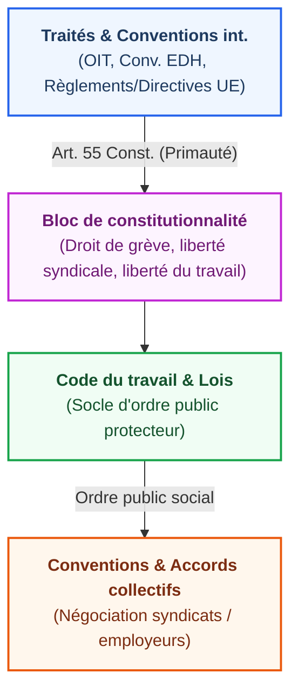
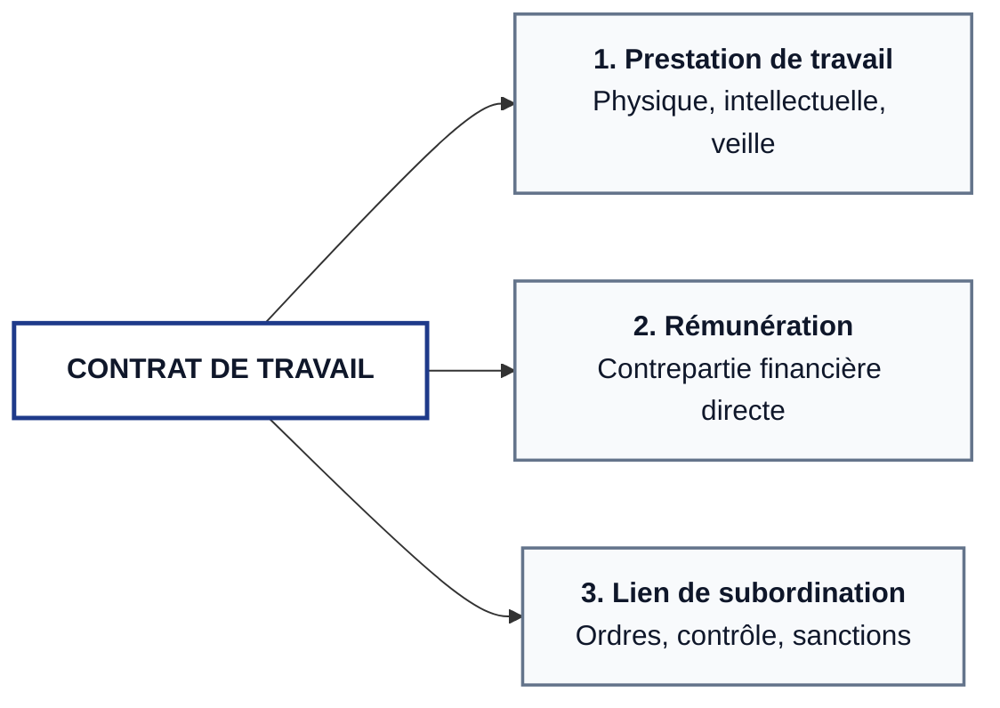

---
{"dg-publish":true,"permalink":"/section-i-introduction-au-droit-du-travail/","tags":["travail","CM","droit","AES/S3"],"dg-note-properties":{"subject":null,"tags":["travail","CM","droit","AES/S3"],"class":"[[References/Travail]]","sector":"[[References/AES]]","semester":"[[References/S3]]","form":"[[References/CM]]","part":"[[References/1]]","date created":"2026-09-10, 13 41","date modified":"2026-10-11, 12 29"}}
---

# Semestre 1 - Droit des relations individuelles de travail
# Section I - Introduction au droit du travail

## I. Historique du droit du travail

> [!abstract] Idée directrice
> Le droit du travail est une discipline **récente**, construite pour rééquilibrer un rapport contractuel asymétrique né de la révolution industrielle.

### 1. Le frein de la Révolution française
Contrairement à l'intuition commune, la Révolution de 1789 a bloqué la création d'un droit protecteur :

* **Dogme de la liberté contractuelle** : liberté absolue de négocier de gré à gré, en ignorant le déséquilibre économique entre employeur et ouvrier.
* **Égalité formelle stricte** : traiter le salarié différemment romprait le principe républicain d'égalité entre citoyens.
* **Proscription des corps intermédiaires** :
  * [[Textes légaux et réglementaires#Loi Le Chapelier (1791)\|Loi Le Chapelier (1791)]] : interdiction stricte de toutes les corporations et coalitions ouvrières (syndicats criminalisés).

### 2. L'essor industriel (XIXᵉ - XXᵉ siècles)
L'exploitation de masse et les luttes ouvrières obligent l'État à intervenir :

| Période         | Événement clé                                                                      | Impact juridique                                                        |
| :-------------- | :--------------------------------------------------------------------------------- | :---------------------------------------------------------------------- |
| **Fin XIXᵉ s.** | Premières lois ouvrières                                                           | Régulation du travail des enfants et des femmes, durée journalière      |
| **1884**        | **[[Textes légaux et réglementaires#Loi Waldeck-Rousseau\|Loi Waldeck-Rousseau]]** | Légalisation des syndicats professionnels                               |
| **1936**        | **Front populaire**                                                                | Congés payés, 40 heures, délégués du personnel, conventions collectives |
| **1973 & 2008** | Recodifications                                                                    | Modernisation et restructuration du Code du travail                     |

### II. Les sources du droit du travail

#### 1. Hiérarchie des sources

#### 2. Rôle des juridictions et traités supranationaux

* **Droit de l'Union européenne** : libre circulation des travailleurs, régulation du détachement, encadrement de la sécurité et de la santé.
* **Organisation internationale du travail (OIT)** : conventions ratifiées créant un standard minimal mondial.
  
  > [!example] Arrêt de principe  
  > **[[Textes légaux et réglementaires#Cass. soc., 1er juillet 2008 (CNE)\|Cass. soc., 1ᵉʳ juillet 2008]]** : le Contrat nouvelle embauche (CNE) français est invalidé car contraire à la convention n° 158 de l'OIT sur la justification du licenciement.

* **Cour européenne des droits de l'homme (Conv. EDH)** : application de [[Textes légaux et réglementaires#Article 8 de la Conv. EDH\|l'article 8]] (protection de la vie privée et secret des correspondances numériques sur l'ordinateur de travail).

## III. Le contrat de travail

### A. Définition et principe de réalité

> [!quote] Définition jurisprudentielle de référence
> [[Textes légaux et réglementaires#Cass. civ., 22 juillet 1954\|Cass. civ., 22 juillet 1954 (Bull. civ. IV, n° 576)]]  
> " Le contrat de travail est une convention par laquelle une personne s'engage à travailler pour le compte d'une autre et sous sa subordination moyennant une rémunération. "

> [!warning] Principe de réalité
> La qualification juridique dépend exclusivement des **conditions de fait** de l'activité, et non de l'intitulé inscrit sur le contrat par les parties (jurisprudence constante applicable aux plateformes comme Uber ou Deliveroo).

### B. Les trois critères constitutifs

#### 1 . La prestation de travail

* **Caractère personnel et physique** : seule une **personne physique** peut être salariée (la sous-traitance par le salarié est impossible).
* **Effectivité** : la prestation doit être réelle (nullité des emplois fictifs).
* **Diversité admise** : la tâche peut être active ou passive ([[Textes légaux et réglementaires#Cass. soc., 18 juillet 2001 (Veille de dépôt pétrolier)\|Cass. soc., 18 juillet 2001]] : simple veille d'un dépôt pétrolier sans effort continu).

Affaire de *L'Île de la tentation* ([[Textes légaux et réglementaires#Cass. soc., 3 juin 2009 (Île de la tentation)\|Cass. soc., 3 juin 2009]])  
La requalification en contrat de travail est retenue :
1. La prestation consiste à participer à des activités imposées et exprimer des réactions guidées en vase clos.
2. Le cadre paradisiaque et le caractère ludique ne sont que le décor d'une prestation sous directives.

> [!tip] Cas particulier : Le stage
> Le stage a une finalité exclusivement formative encadrée par une convention tripartite école/entreprise/étudiant ([[Textes légaux et réglementaires#Cass. soc., 14 novembre 2000 (Stage)\|Cass. soc., 14 novembre 2000]]).  
> **Sanction :** s'il compense un accroissement d'activité ou occupe un emploi permanent, il est requalifié judiciairement en **CDI** ([[Textes légaux et réglementaires#Cass. soc., 18 juillet 2001 (Requalification de stage)\|Cass. soc., 18 juillet 2001]]).

#### 2 . Rémunération

* Elle est indispensable à la caractérisation d'un contrat de travail, bien que d'autres formes de contrats prévoient une rémunération.
	* Cependant, si la rémunération est exclue, la qualification de contrat de travail est pas définition exclue (ex. bénévolat )
	* Le renoncement à cette rémunération doit être consentie par les deux parties.
  
* La qualification donnée à cette rémunération n'est pas importante ([[Textes légaux et réglementaires#Cass. soc., 11 novembre 1991 (Qualification de la rémunération)\|arrêt du 11 novembre 1991]])
	* A l'inverse, un contrat qui parle expressément de salaire n'oblige pas à le définir en contrat de travail, pour cela on regarde le lien de subordination des parties au contrat ([[Textes légaux et réglementaires#Cass. soc., 5 février 1992 (Mention salaire neutre)\|arrêt du 5 février 1992]])
  
* Le mode de calcul est neutre et n'impose pas de qualification de contrat de travail (rémunération à l'heure, à la tâche)
	* La rémunération peut-être fixe ou variable (ex. une commission), en argent ou en nature (comme la fourniture d'un logement). Le versement en nature n'exclue pas la qualification en contrat de travail.
  
* Si le contrat de travail est reconnu, le salarié a droit au salaire minimum ou prévu par la convention collective, peu importe la méthode de versement.
  
#### 3 . Le lien de subordination

> [!abstract] Le contrat de travail est défini par le lien de subordination. Le salarié se soumet au pouvoir de direction de l'employeur.
  
* Il est parfois difficile à caractériser, car il peut prendre des formes et des intensités assez variables selon les situations.
	* Un médecin d'une clinique a plus de liberté, moins de subordination qu'un ouvrier.

* Le lien de subordination **n'est pas une dépendance économique**
	* pour la cour de cassation, un artisan dépendant uniquement d'un unique client n'est pas un lien de subordination [[Textes légaux et réglementaires#Cass. civ., 6 juillet 1931 (Arrêt Bardou)\|6 juillet 1931]], c'est une notion juridique qui implique que le travailleur, par contrat, accepte de se mettre au pouvoir de direction de son donneur d'ordre.
	  
	* un arrêt du [[Textes légaux et réglementaires#Cass. soc., 13 novembre 1996 (Arrêt Société Générale)\|13 novembre 1996]] dit que le lien de subordination implique que : 
		1. l'employeur ait le pouvoir de donner des ordres et directives
		2. le pouvoir de contrôler l'exécution de ces directives
		3. le pouvoir de sanctionner les manquements du salarié aux ordres et directives
   
##### a . Le pouvoir de direction

* Le pouvoir d'organiser l'entreprise comme on l'entend. L'employeur, à ce titre, **à le pouvoir d'organiser le travail des salariés.**
	* L'employeur peut l'exercer directement, mais également via l'intermédiaire de son préposé, d'une délégation de pouvoir à d'autres salariés d'exercer ce pouvoir de direction
  
* Il ne peut pas y avoir de lien de subordination, et donc de contrat de travail, sans pouvoir de direction. 
	* L'arrêt du [[Textes légaux et réglementaires#Cass. soc., 15 février 2006 (Absence d'instructions)\|15 février 2006]] implique l'absence de consignes de directions empêche la qualification en contrat de travail.
	* A contrario, le pouvoir de donner des consignes n'implique pas de lien de subordination (comme lors d'une prestation de service)

##### b . Le pouvoir de contrôle

* L'employeur doit avoir le pouvoir de contrôler le respect des consignes pour pouvoir établir un lien de subordination.
	* Là encore, la vérification à la suite d'une prestation n'est seule pas une qualification suffisante.

##### c . Le pouvoir de sanction

* Pour pouvoir parler de lien de subordination, il faut pouvoir sanctionner un salarié pour ces manquements, généralement à la suite d'un contrôle. La conséquence de la sanction, **l'exécution du pouvoir disciplinaire**, est la caractéristique majeure du lien de subordination.
* Contrairement à la réparation au titre de la responsabilité contractuelle, le pouvoir de sanction disciplinaire n'appartient qu'à l'employeur. Il ne vise à un moment la réparation, est unilatéral.
* Le pouvoir disciplinaire n'a pas besoin d'être exercé dans les faits pour être démontré.
  
##### d . Exemples

* [[Textes légaux et réglementaires#Cass. soc., 24 avril 2013 (Sanctions pécuniaires)\|L'arrêt du 24 avril 2013]] relève des pouvoirs de direction non déclarées dans le contrat, de sanctions pécuniaires en cas d'abandon du contrat de travail (ce qui est illégal)

* Les livreurs travaillant avec les plateformes numériques Les prestations matérielles, le [[Textes légaux et réglementaires#Cass. soc., 28 novembre 2018 (Arrêt Take Eat Easy)\|28 novembre 2018]], un arrêt détermine la qualité de contrat de travail des salariés de take it easy
	* Un pouvoir de contrôle avec un suivi GPS des partenaires commerciaux

* Le [[Textes légaux et réglementaires#Cass. soc., 4 mars 2020 (Arrêt Uber)\|4 mars 2020]], la cour de cassation reconnaît le lien de subordination d'Uber sur ses chauffeurs, et le contrat a été requalifié en contrat de travail
	* La plateforme imposait un pouvoir de direction à ses salariés en choisissant ses itinéraires
	* Un pouvoir de sanction et de déréférencement s'activait en cas de refus d'une course

	* Le [[Textes légaux et réglementaires#Décision du 9 juillet 2025 (Uber)\|9 juillet 2025]], après révision des conditions contractuelles et de l'algorithme d'Uber, la réalité de la subordination juridique n'a pas pu être établie _in concreto_.  
	  En l'absence de directives impératives ou de sanctions directes prouvées, la présomption de non-salariat de l'article L. 8221-6 du Code du travail a été maintenue.

## IV. La preuve du contrat de travail

### A. Les principes généraux

#### a. La charge de la preuve

Article 1353 du Code civil : 
* Si le salarié invoque l'existence d'un contrat de travail, ce sera à lui d'en apporter la preuve et de démontrer les 3 conditions du lien de subordination
* Si un employeur veut écarter un contrat de travail, c'est également à lui d'apporter la charge de la preuve
  
> [!abstract] - La preuve du contrat de travail est un acte juridique. La preuve peut se faire par tout moyen, et pas nécessairement par écrit, vertu de l'arrêt [[Textes légaux et réglementaires#Cass. soc., 28 avril 1955 (Liberté de la preuve)\|du 28 avril 1955]]. Peu importe la volonté apparente exprimée par les parties au contrat, ou ce qui a été écrit.

* Dans l'hypothèse où un contrat de travail est remis à l'employeur, la cour de cassation considère que l'on a une **présomption simple** d'existence d'un contrat de travail, selon l'arrêt du [[Textes légaux et réglementaires#Cass. soc., 26 juin 1969 (Apparence de contrat)\|26 juin 1969]]
	* C'est une présomption simple, donc l'employeur peut s'en dédouaner
  
* Le contrat de travail n'a pas besoin d'être écrit. Il peut être verbal ou tacite, mais la preuve du contrat de travail sera plus difficile à faire admettre. Certains contrats spéciaux imposent d'être établis par écrit :
	* les CDD
	* les contrats à temps partiels

#### b. La preuve du lien de subordination

* Les juges vont utiliser la méthode du **faisceau d'indice**. Une somme d'éléments qui individuellement ne sont pas probants, mais qui pris ensemble peuvent permettre de prouver l'existence d'un lien de subordination. Le juge va ensuite juger selon l'analyse qu'a permis la lecture de tout les éléments.
  
* Dans les éléments retenus, on retrouve
	* Le service organisé
	* Les contraintes horaires (là aussi, seul ce n'est pas suffisant)
	* La détermination du lieu de travail
	* La fourniture du matériel nécessaire à la prestation de travail

* Des salariés avec une certaine latitude ou autonomie sont qualifiés comme subordonnés dès lors qu'ils se soumettent à un service organisé, un cadre de travail au sein duquel le travailleur va fournir sa prestation, selon un arrêt du [[Textes légaux et réglementaires#Cass. soc., 13 novembre 1996 (Arrêt Société Générale)\|13 novembre 1996]]
	* Un sportif professionnel qui sera soumis au calendrier des matchs
	* Un médecin qui travaille dans une clinique

### B - Les présomptions légales

#### a. Les présomptions d'existence du contrat de travail

#### b. Les présomptions irréfragables, les VRP

* Emploi défini à l'article [[Textes légaux et réglementaires#Article L. 7311-3 du Code du travail\|L7311 du Code du travail]]
* Défini comme salarié de son entreprise à [[Textes légaux et réglementaires#Article L. 7313-1 du Code du travail\|l'article L7313-1]]
	* Selon la jurisprudence du 11 mars 1998, le VRP ne peut pas prétendre à un salaire minimum, car ce dernier est trop indépendant. Cela ne s'applique pas dans le cas, selon un arrêt du [[Textes légaux et réglementaires#Cass. soc., 30 juin 1999 (VRP et contraintes horaires)\|30 juin 1999]], de la soumission à des contraintes horaires

#### c. Les présomptions simples

* Dans certains cas, la loi décide que certaines personnes en raison de leur activité professionnelle doivent être considérés comme des salariés de la personne qui la rémunère, mais l'employeur peut toujours démontrer l'absence de lien de subordination
	* C'est le cas des journalistes professionnels ([[Textes légaux et réglementaires#Article L. 7112-1 du Code du travail\|article L7112-1 du Code du travail]])
	* Les artistes de spectacle payés par un organisateur de spectacle sont considérés comme les salariés de ce dernier ([[Textes légaux et réglementaires#Articles L. 7121-1 à L. 7121-4 du Code du travail (Artistes du spectacle)\|art. L. 7121-2]])
	* Les mannequins professionnels sont considérés également comme des salariés ( [[Textes légaux et réglementaires#Articles L. 7123-3 et L. 7123-4 du Code du travail (Mannequins)\|L7123-3]] )

### C - Présomption d'absence de contrat de travail

* Le cas où la loi va décider que certaines personnes sont considérés comme des travailleurs indépendants et non des [[Textes légaux et réglementaires#Article L. 8221-6 du Code du travail (Présomption de non-salariat)\|L8221-6]] des salariés des personnes qui les emploient :
	* Toutes les situations où les travailleurs sont immatriculés officiellement en tant que travailleurs indépendants, et sont considérés comme n'étant pas les salariés leurs clients. 
	* Les dirigeants sociétés et leurs salariés qui fournissent une prestation au client

> [!abstract] C'est une présomption simple, et ces travailleurs peuvent démontrer que leurs clients ont exercés sur eux un pouvoir de subordination.
>  

