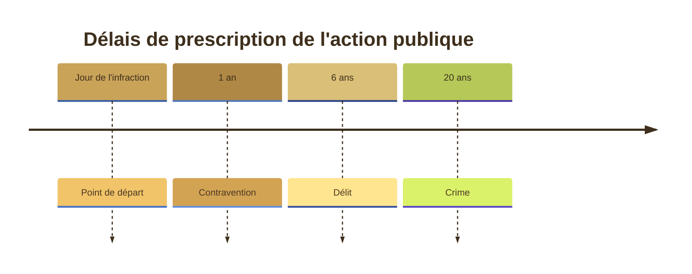

---
{"dg-publish":true,"permalink":"/titre-1-le-fonctionnement-de-la-norme-penale/","tags":["AES/S3/pénal","CM","droit","AES/S3"],"ctime":"2026-09-16T11:50:11.958+02:00","mtime":"2026-10-15T14:40:24.998+02:00","dg-note-properties":{"tags":["AES/S3/pénal","CM","droit","AES/S3"],"class":"[[References/Pénal]]","sector":"[[References/AES]]","semester":"[[References/S3]]","form":"[[References/CM]]","part":"[[References/1]]","date created":"2026-09-16, 11 50","date modified":"2026-10-15, 14 40"}}
---

# Partie 1 - La norme pénale

# Titre 1 - Le fonctionnement de la norme pénale

- **Principes généraux** : **[[Article 111-1\|Article 111-1]]**, le premier article, affirme la classification tripartite des infractions, à savoir
	- Les crimes
	- les délits
	- les contraventions
	  
> [!cite] **[[Article 111-1\|Article 111-1]] :** *Les infractions pénales sont classées, suivant leur gravité, en crimes, délits et contraventions.*
> 

## Chapitre 1 - La définition légale de l'infraction

- **Classification des infractions** : 
	- selon leur gravité
	- selon leur nature

	  Le critère de la peine principale est alors retenu pour caractériser une infraction en rapport avec la qualification légale  
	  *La peine principale étant la peine principale prévue par le législateur pour l'infraction considérée, encourue, déterminé dans un plafond maximal légal*

- Tripartition légale des infractions  
La doctrine propose également une classification basée sur la nature légale des infractions

### 1 . Contraventions
- Une **contravention** est une infraction issue d'une **peine contraventionnelle.**
  
- Selon **l'échelle des peines**, elle est exclusivement une peine d'amende qui **n'excède pas 1500€**

> [!info] Il n'y a pas de peine privative de liberté en termes contraventionnels.
> 

- Le législateur distingue 5 types de contraventions :
	- Peine 1er classe : 38€
	- Peine 2e classe : 150€
	- Peine 3e classe : 450€
	- Peine 4e classe : 750€
	- Peine 5e classe : 1500€
### 2 . Délits
- Un **délit** est une infraction punie de **peine délictuelle**. C'est à dire une peine d'amende ***et/ou*** une peine privative de liberté

> [!info] En matière délictuelle, on utilise le terme emprisonnement
> 

- En matière criminelle, **l'amende n'a pas de plafond**. Le législateur pose un plancher minimum de 3750€
  
- En terme de privation de liberté, le législateur dispose d'une **échelle légale** :

### 3. Crimes
- Un **crime** est une infraction punie d'une **peine criminelle**. La peine criminelle est exclusivement une **peine privative de liberté.**
  
> [!info] On ne parle plus d'emprisonnement mais de **réclusion criminelle.**
> 

- Elle comporte là aussi une échelle légale, appelée **réclusion à temps** :
	- 15 ans pour le 1er degré,
	- 20 ans pour le second degré
	- 30 ans pour le troisième
	- La réclusion criminelle à perpétuité

- On ne se limite jamais à l'infraction de base, des **circonstances** vont avoir pour effet **d'aggraver la prescription.**
> [!example] Ex. Un vol, un délit de base, mais à main armé, passe à un crime du premier degré, le vol à main armé. L'emprisonnement devient réclusion criminelle, et dans ce cas on trouve une amende lors d'une infraction criminelle par sa nature délictuelle et le prisme d'une circonstance aggravante (1M5k€ d'amende).
> 

### 4 . Les intérêts à la classification
- Cette classification emporte des conséquences à la fois du point de vue **des sources et des organes** ayant compétences pour créer des infractions, que **du point de vue procédural** car un certain nombre de règles du procès pénal dépendent de cette classification.
--- 
Du point de vue des sources, [[l'article 111-2 du Code pénal\|l'article 111-2 du Code pénal]] dispose :
> [!cite] *La loi détermine les crimes et délits et fixe les peines applicables à leurs auteurs.* *Le règlement détermine les contraventions et fixe, dans les limites et selon les distinctions établies par la loi, les peines applicables aux contrevenants.*
> 

- **Crimes et délits** = **Parlement seul** (loi). Seul habilité à prévoir des peines d'emprisonnement.
- **Contraventions** = **Gouvernement** (décret en Conseil d'État). Amendes strictement encadrées par la loi, jamais de prison.
- **Juge pénal** : a le pouvoir d'écarter un règlement illégal (art. 111-5 CP).
---
Outre les sources légales, au niveau du droit pénal de fond, toute une **série de règle** conditionne la **classification tripartite des infractions** :
  
- Du point de vue de **l'élément moral**
	- la nature de la faute peut être **volontaire ou involontaire** en matière de contravention et de délit,
	- mais **exclusivement volontaire** en matière de crime.
	  *Ex. En effet, il y a pas d'homicide non-intentionnel*

- Au niveau de la tentative, il y a deux façons d'être auteur, d'une **infraction consommée** et d'une **tentative**
	- Ex. La **pensée** n'est pas punissable, la **préméditation** n'est pas punissable, la **tentative** l'est toujours, l'**infraction consommée** l'est
	- En matière de délit, la tentative est punie exclusivement dans les cas **pensés par le législateur**
	- Enfin, en matière de contraventions la tentative **n'existe pas**, elle n'est donc jamais punissable
---
- La classification a également son importance dans **l'application de la loi dans le temps**
---
- **Le droit pénal de forme** est aussi tributaire de la classification tripartite des infractions
  - Ex. Le crime dépend de la compétence de la **cour d'Assises**
  - La juridiction compétente des délits est le **tribunal correctionnel**
  - Pour les contraventions, le tribunal de **Police**
 
- Dans le droit pénal de forme, la classification tripartite influence également le **catalogue d'infraction** 
	- Ex. L'instruction en matière **criminelle** est **obligatoire**
	- Alors qu'elle est **facultative** en terme de **délit** et **d'infraction**
---
- **L'action publique**, l'action par lequel le ministère public, représentant de l'État, va exercer les poursuites et déclencher le procès pénal. Cette action publique est soumise à des **délais de prescription** qui varient en fonction de la classification tripartite des infractions. Puisque ces délais courent à compter du jour de la commission d'infraction et à l'expiration de ceux-ci, l'action publique est dite **prescrite**.
  *Ex. Un auteur peut tenter ou commettre une infraction, à l'issue du délai on ne pourra le juger*
  
  Les délais sont :
  - **1 an** pour les contravention à compter du jour de la commission de l'infraction
  - **6 ans** pour les délits
  - **20 ans** pour les crimes

## Chapitre 2 - Le principe de légalité

> [!quote] Becaria - Traités des délits et des peines, 1964
> "*Nullum crimen nulla poena sine lege*"

- Ce principe est exprimé à l'article [[111-3 du Code Pénal\|111-3 du Code Pénal]] 
> [!quote] Article 111-3
> Nul ne peut être puni pour un crime ou pour un délit dont les éléments ne sont pas définis par la loi, ou pour une contravention dont les éléments ne sont pas définis par le règlement.
> Nul ne peut être puni d'une peine qui n'est pas prévue par la loi, si l'infraction est un crime ou un délit, ou par le règlement, si l'infraction est une contravention.

- En effet, le principe de légalité vise aussi bien **l'incrimination** que la **peine**. Il signifie qu'il faut nécessairement l'existence d'une norme pénale **préexistante** à l'acte d'incrimination et à sa sanction.
  
  De ce point de vue, le principe de légalité a une fonction **symbolique** dans la mesure  :
	- où tout ce qui n'est pas interdit pénalement est **autorisé**
	- Cela préserve aussi la **sécurité juridique**
	- et permet d'empêcher l'**arbitraire** du juge.
  
### 1 . Signification du principe à l'égard du juge pour les infractions
- Le juge ne peut pas créer **arbitrairement** des infractions. Il a donc **l'obligation** de vérifier l'existence d'un texte répressif pour considérer que les effets dont il est saisi sont **punissables**. Obligation qui  renvoie à la **qualification juridique des faits** , c'est à dire l'opération intellectuelle qui consiste pour le juge à confronter les **faits** dont il est saisi à la **norme pénale applicable**

> [!caution] - Tout les comportements qui ne font l'object d'aucun texte pénal échappent à la répression. Il ne convient pas au juge de palier à l'insuffisance d'un texte.
> 
### 2 . Signification du principe à l'égard du juge pour les peines
- Pour chaque infraction, un texte doit prévoir à l'avance une peine déterminée dans son ***quantum*** (les peines encourues) et dans **ses modalités d'application**. Le juge doit prononcer la sanction alors dans la limite de ce qu'à prévu le législateur, c'est à dire respecter les **peines principales**, les **plafonds encourus** des incriminations.
- **Il n'a pas à prononcer** les peines légalement encourues, il peut **diminuer** les quantum, ou **assortir** les quantum de certaines modalités prévues par le code pénal, en fonction des **circonstances** et de la personnalité du délinquant, en vertu du **principe de personnalisation**.

> [!success] Le ***principe de personnalisation*** est un principe à valeur constitutionnel vu à **l'article 8 de la DDHC** et consacrée par le conseil constitutionnel le **22 juillet 2005**

### 3. Conséquences à l'égard du législateur
- Encore faut-il que le texte soit suffisamment **clair** et **précis**, dans sa peine
  
  **Exigence constitutionnelle de qualité du texte pénal**, qui ressort de la **[[décision fondatrice rendue en la matière les 19 et 20 janvier 1981 \|décision fondatrice rendue en la matière les 19 et 20 janvier 1981 ]]**
	- Le conseil constitutionnel peut **censurer** **une** décision qui ne serait pas **conforme** à ce principe constitutionnel
> [!example] Ex. **le harcèlement sexuel**, définit de manière imprécise avec le seul mot *harceler*, est **[[abrogé le 4 mai 2012\|abrogé le 4 mai 2012]]** car ne répondant pas à l'exigence de clarté et de décision. **[[Loi du 6 août 2012\|Loi du 6 août 2012]]**, le harcèlement sexuel revient dans le code Pénal et le définit clairement.
> 

- En comparaison, la cour européenne des Droits de l'Homme est beaucoup moins exigeante au regard de la légalité des textes. Elle considère au même titre **le texte** de **la jurisprudence** au regard du droit.
> [!example] Ex. **[[L'arrêt Cantoni contre France, l'arrêt de 1996\|L'arrêt Cantoni contre France, l'arrêt de 1996]]** considère que ***"la condition de clarté*** est remplie lorsque le justiciable peut savoir à partir du libellé de la disposition pertinente et au besoin à l'aide de son interprétation par les tribunaux quels **actes** et **omissions** engagent sa responsabilité pénale"

### 4. Les forces et les faiblesses du principe de l'égalité
##### A. Faiblesses (ou imperfections)
1. Renvoie à l'article **[[l'article 111-2 du Code pénal\|l'article 111-2 du Code pénal]]**, le principe de légalité est ***parlementaires***, qui sont élus et représentent le peuple
	- il doit être vu au sens **==formel==**

Mais on a vu que la source de norme pénale peut-être la loi mais également le **règlement**, ***l'exécutif*** au sens propre.
	- On est davantage sur un principe de ==**textuel**==. La légalité devient ***matérielle*** : ce qui importe, c'est l'existence d'un texte.

Cela affaiblit le pouvoir du législateur dans le sens ***formel***, dans sa capacité à **éditer** des textes issus du droit pénal.

2. L'usage de termes **==vagues==** dans les **incriminations**, quand le conseil constitutionnel requiert des éléments **clair** et **précis**
   
3. Le **==renvoi==** à un autre texte, une technique d'incrimination qui utilise une **autre norme** pour définir une infraction, qui **dilue** la précision et la clarté de la norme.
   
4. Une ==**imprécision**== dans la largeur dans la norme de pénalité, dont la formulation peut-être susceptible à un grand aléa
   Ex. Le *délit d'initié*, dont l'incrimination est tributaire du montant subtilisé par son auteur
##### B. Forces 
1. De multiples contrôles sont organisés
	1. Le contrôle de la norme pénale exercé par le juge judiciaire. Il n'a pas pour effet de censurer la norme pénale, mais d'écarter le texte de l'application à l'espèce.
   > [!info] Le texte **reste en vigueur**, mais il ne sera pas appliqué à l'espèce
> 
###### a. Le contrôle spécifique des normes contraventionnelles ou **==l'exception d'illégalité==**
  
- Une norme qui va faire l'objet d'un **contrôle** par le juge judiciaire à la demande du justiciable.
- En application "***In limine litis***", **avant toute défense du fond**. Le juge sera dans l'obligation de statuer sur la légalité et, cas échéant, il serait contraint d'écarter la norme.
- En revanche pour faire **annuler** un texte, il faut consulter le juge administratif, à savoir 
	- le Conseil d'État
	- les AAI (Actes Administratifs Individuels)
	- les REP (Recours pour excès de pouvoir)
Ce dispositif est prévu à l'article [[111-5\|111-5]] du Code Pénal

Les **juridictions pénales** sont compétentes pour interpréter les actes administratifs, réglementaires ou individuels et pour en apprécier la légalité lorsque, de cet examen, dépend la solution du procès pénal qui leur est soumis.

Deux étapes :
1. Le juge doit ***examiner la question de sa compétence***
2. Il va apprécier la ***légalité contraventionnelle***
   
> [!tldr] En conclusion
> Le contrôle de légalité ne peut s'opérer que si les éléments constitutifs d'une infraction sont déterminés par l'acte administratif
>
> Il ne peut donc pas s'opérer lorsque la sanction pénale prévue est automatique et ne dépend pas d'une décision administrative.
>

***Exemple*** : Le permis à point instauré le [[10 juillet 1989\|10 juillet 1989]]

1. **[[Arrêt 11 juillet 1994\|Arrêt 11 juillet 1994]]** Le tribunal se dit **incompétent** à juger l'exception d'illégalité, dont la contravention n'est que la conséquence du système de point

2. **[[Arrêt Roche 1996\|Arrêt Roche 1996]]**, le juge pénal s'est déclaré **compétent** pour déclarer son contrôle des normes contraventionnelles. Le refus de restitution du permis de conduire fait suite à l'arrêt total de point, on est bien dans une solution administrative dont est **compétent** le juge pénal.

On passe donc à la 2e étape, **l'appréciation de validité***, si la loi est conforme à la hiérarchie des sources et donc à la norme européenne.
Ici, la cour a considéré que le système de retrait de point était tout à fait légal, car chaque perte partielle de point est subordonnée à la reconnaissance de la culpabilité de l'auteur

Ici le contrôle de légalité est large, il intègre à la fois 
1. Un ==**contrôle au regard de la norme supérieure interne**==
2. Mais aussi au regard de la norme européenne, un ==**contrôle de conventionnalité**== 
Le juge pourrait considérer qu'un texte puisse être illégal en cas d'une norme violant le principe de légalité.

###### b. Le contrôle applicable à toutes les normes pénales, le contrôle de conventionnalité
- Il se trouve bien dans les contrôles l'illégalité mais également dans toutes les normes pénales, conformément à **[[l'article 55 de la Constitution de 1958\|l'article 55 de la Constitution de 1958]]**, le juge peut contrôler la norme et adapter sur le fond ou sur la forme à la conventionnalité européenne
- Là aussi, cela peut être le fait du justiciable comme celui d'un juge qui peut le relever d'office et s'auto-saisir.

> [!info] **Normes pénales de forme**
> 1. **Les dispositions en matière de garde à vue**
>>   La chambre criminelle a sanctionné ces dispositions pour manquement, le [[le 11 avril 2011\|le 11 avril 2011]], à la conventionnalité, et applique immédiatement en l'espèce la norme européenne, puis dans un second la norme du juge en la matière de garde à vue
>
> 2. La dissimulation du visage 
>> Invoqué devant le juge pénal au regard de l'[[article 9 de la constitution\|article 9 de la constitution]], celui des signes religieux. Le juge a invoqué le 5 mars 2013 les impératifs de sécurité.

##### 2. Le contrôle par le juge juridictionnel, ou le contrôle de constitutionnalité (QPC)

1. Il va pouvoir censurer une disposition législative, à la demande du justiciable lors d'une procédure pénale et criminelle, toujours selon le principe in limine litis, c'est le contrôle **a posteriori**
2. Il y a également le contrôle **a priori** où la loi est saisie par les parlementaires, et censurée par le Conseil constitutionnel en cas de non respect au regard du principe d'exigence de ce dernier de clarté et de précision
3. **Le contrôle exercé par le juge européen**, si l'absence de normes est insuffisante au regard du droit inscrit dans la constitution
   
## Chapitre 3 - Le principe de l'interprétation stricte

***Interprétation*** : Consiste à **chercher le sens exact** de la norme pénale pour en déterminer le domaine d'application.
Par la suite, le juge opère la **qualification pénale**
Autrement dit, ==**l'interprétation est le** **préalable**== à la qualification pénale des faits.

On donne un juge un **guide***, inscrit dans **[[l'article 111-4\|l'article 111-4]]**, qui va donner une méthode d'interprétation au juge 
"La loi pénale est d'interprétation stricte."

### I/ Interpréter strictement le texte ne signifie pas interprétation littérale par le juge

- ==L'interprétation littérale est **possible** mais elle n'est **pas obligatoire**==
  
- ==L'interprétation stricte **prohibe** toute forme de raisonnement par ***analogie**==*
  
	- L'***analogie*** est totalement prohibée en droit pénal. Elle consiste à considérer que le texte s'applique à des situations qui ne sont pas prévues par le législateur mais qui présente des similitudes cette dernière. Si cela était autorisé, le juge ferait appliquer la norme pénale à des situations non expressément prévues par le législateur.**
	
> [!question] Ex. Le contentieux relatif à l'enfant à naître
> **Situation 1** : Une femme est victime d'un accident de la route, elle est heurtée par une voiture et souffre de séquelles suite à une chute. La chute est responsable de l'enfant à naître, peut-on poursuivre la personne responsable de la chute ?
> 
>  **Situation 2** : [[Affaire Vaux\|Affaire Vaux]], et l'interversion des dossiers entre un retrait de stérilet et un contrôle de grossesse donnant lieu à la perte d'un enfant à naître. Peut-on poursuivre le médecin responsable de la confusion ?
>  
> Pour les deux situations la même question : *Peut-on condamner l'individu pour homicide involontaire sur l'enfant à naître ?*
> 1. La cour regarde la définition de l'homicide involontaire, le fait de causer involontairement la mort à autrui
> 2. Pour l'application en espèce, elle doit vérifier le contenu en interprétation stricte, et ne peut pas agir en analogie sur l'éventualité de l'enfant à naître. Elle ne peut pas légiférer. 
> 3. En conséquence les deux personnes n'ont pas été condamnées, ont été relaxées, car le législateur ne peut pas extrapoler.

- ==L'interprétation stricte autorise le raisonnement téléologique==, s'inspirer de l'esprit de la loi pour pouvoir l'appliquer aux faits commis. S'inspirer de l'esprit de la loi est en quelque sorte respecter le souhait du législateur.
  Ex. L'interdiction de conduire sans s'assurer que l'on a toutes les facultés matérielles de pouvoir le faire

- ==L'interprétation stricte de la norme pénale a néanmoins permis au juge de raisonner ***contra legem***== (contraire à la loi, au texte). Le juge sous couvert d'interprétation peut parfois dénaturer une norme pénale.
  
  Ex. En droit pénal des affaires à travers l'abus de biens sociaux, qui caractérise l'usage de biens de la société à des fins contraires à celle-ci et dans un intérêt personnel. L'usage implique une **action**, mais le juge dans la cour de cassation a intégré la non-réclamation d'une dette dans les **critères** de l'abus de biens sociaux, de manière *contra legem*. Le juge opère un **dévoiement** vis à vis du texte, mais **opéré par la chambre criminelle**, à l'encontre de ce que prévoit le législateur
  
  - ==L'affaire du sang contaminé== [[Crim., 18 juin 1993 (Affaire du sang contaminé)\|Crim., 18 juin 1993 (Affaire du sang contaminé)]] où l'infraction par empoisonnement, un dol spécial **strictement intentionnel**, n'a pas été retenue par les juges du fond, faute de preuve d'intention de tuer. L'élément moral *volontaire* va être caractérisé pour pouvoir prononcer un ***dommage***, sous couvert d'interprétation stricte
    
    En *contra legem*, **aucune pression** ne peut s'exercer sur le juge si cela est opéré par la chambre criminelle
    Dans le sang contaminé sera retenu une infraction non-intentionnelle sur les biens et pas un empoisonnement

# Titre 2 - L'application de la norme pénale
## Chapitre 1 - L'application de la loi pénale dans le temps
## Chapitre 2 - L'application de la loi dans l'espace